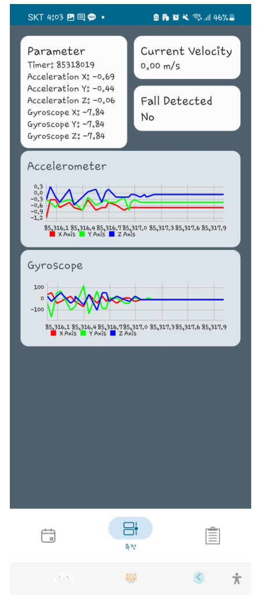
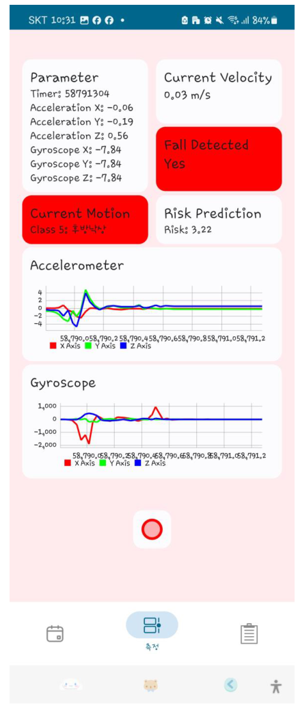

# BLE 센서와 AI 모델을 연결한 Android 연구 앱

[포트폴리오](../README.md) · [TinyFallNet](05-tinyfallnet.md)

PC에서 개발한 모델을 휴대전화에서 직접 실행하고 싶었습니다. 센서 연결부터 신호 확인, 데이터 저장, 추론 결과 표시까지 한 앱에서 할 수 있도록 만들었습니다.

**2023.09–2024.01 · 연세대학교 생체역학연구실**  
Android Studio · Kotlin · Jetpack Compose · BLE · TensorFlow Lite

## 1. 개발한 화면

| 센서 신호 확인·저장 | 낙상·동작 인식 결과 |
|---|---|
|  |  |

*개인 포트폴리오 15쪽에 수록한 당시 앱 화면입니다.*

## 2. 제가 구현한 기능

1. **BLE 연결:** 센서를 검색하고 연결해 IMU 데이터를 받았습니다.
2. **차트와 저장:** 가속도·각속도를 실시간 차트로 표시하고 측정 데이터를 저장했습니다.
3. **모델 통합:** TensorFlow 모델을 TensorFlow Lite로 변환해 앱에서 실행했습니다.
4. **결과 표시:** 낙상 여부와 수행 동작, 위험도 관련 출력을 신호와 함께 볼 수 있도록 구성했습니다.

## 3. 연구를 앱으로 옮기며

모델의 입력 형태를 맞추는 것뿐 아니라 센서가 연결됐는지, 데이터가 정상적으로 들어오는지, 어떤 구간에서 결과가 바뀌는지를 사용자가 확인할 수 있어야 했습니다. 이 앱은 연구실에서 알고리즘을 확인하기 위한 도구로 개발했습니다.

이후 회사에서는 장치 상태·기록·업데이트를 다루는 [SW AIRBAG 관리 앱](08-sw-airbag-suite.md)을 개발했습니다.
