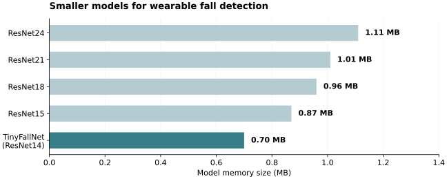
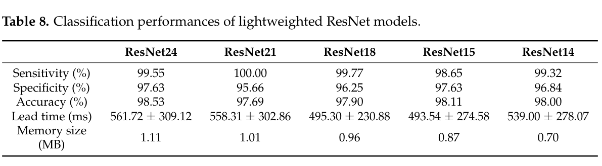

# TinyFallNet · 충격 전에 낙상을 알아채는 작은 모델

[포트폴리오](../README.md) · [연구 목록](../research.md)

웨어러블 에어백은 넘어졌다는 사실을 아는 것만으로는 충분하지 않습니다. 몸이 바닥에 닿기 전에 낙상을 알아채야 하고, 작은 장치에서 실행할 수 있어야 합니다. 이 두 조건을 함께 고려해 **TinyFallNet**을 개발했습니다.

**2022년 연구 · 2023년 Sensors 게재 · 제1저자**  
Python · TensorFlow · ConvLSTM · ResNet · IMU

## 1. 제가 맡은 일

선행 ConvLSTM 모델을 재현하고 VGGNet·ResNet의 구조를 비교했습니다. 이후 ResNet의 층과 블록을 줄여가며 모델 크기, 검출 성능, 충격까지 남은 시간을 함께 평가했습니다. 연구 설계부터 모델 구현, 분석, 시각화와 논문 초고 작성을 담당했습니다.

*Koo et al., 2023, Figure 4. 논문 원본 그림, [CC BY 4.0](https://creativecommons.org/licenses/by/4.0/). [원문](https://doi.org/10.3390/s23208459)*

## 2. 모델을 어디까지 줄일 수 있을까

IMU 입력에 맞게 ResNet을 단순화해 **14층, 0.70 MB** 모델을 만들었습니다. ResNet24의 1.11 MB에서 약 **37%** 줄어든 크기입니다. 아래는 같은 KFall 시험 조건에서 비교한 결과입니다.

| 모델 | 메모리 | 민감도 | 특이도 | 정확도 | 검출 선행시간, 평균 ± 표준편차 |
|---|---:|---:|---:|---:|---:|
| ResNet24 | 1.11 MB | 99.55% | 97.63% | 98.53% | 561.72 ± 309.12 ms |
| ResNet21 | 1.01 MB | 100.00% | 95.66% | 97.69% | 558.31 ± 302.86 ms |
| ResNet18 | 0.96 MB | 99.77% | 96.25% | 97.90% | 495.30 ± 230.88 ms |
| ResNet15 | 0.87 MB | 98.65% | 97.63% | 98.11% | 493.54 ± 274.58 ms |
| **TinyFallNet / ResNet14** | **0.70 MB** | **99.32%** | **96.84%** | **98.00%** | **539.00 ± 278.07 ms** |

*논문 Table 8을 표와 그래프로 재구성했습니다. KFall 젊은 성인 32명 중 26명으로 학습하고 6명으로 시험했으며, 학습 데이터의 20%를 검증에 사용했습니다. 입력은 가속도·각속도 6축, 50프레임(0.5초)입니다. 성능은 파일 단위 판정이며, 선행시간은 충격 시점에서 첫 검출 시점을 뺀 값입니다. Table 8에는 시험 파일의 총수가 별도로 기재되어 있지 않습니다.*

논문 Table 8 원본 보기

## 3. 고령자의 움직임에서도 통할까

젊은 성인의 모의 낙상으로 학습한 모델을 고령자 데이터에 적용하자, 앉거나 일어나는 동작에서 오경보가 늘었습니다. 일시적인 흔들림과 낙상으로 이어지는 움직임을 구별하도록 시간에 따른 판정을 보완했습니다.

| 평가 데이터 | 수정한 알고리즘의 결과 |
|---|---|
| FARSEEING 실제 고령자 낙상, 8명·15건 | **13/15건 검출 · 민감도 86.67%** |
| KFall 고령자 일상동작, 10명·640건 | **627/640건 정상 판정 · 특이도 97.97%** |
| 검출 선행시간 | **477.7 ± 5.8 ms** |

*논문 §3.6의 저장 데이터 평가입니다. FARSEEING의 센서 구성에 맞춰 가속도 3축으로 학습한 모델을 사용했습니다. 위의 6축 모델 비교와는 입력과 시험 대상이 다릅니다.*

## 4. 이 연구에서 얻은 것

모델을 줄이는 일과 실제 사용자의 움직임에 적응시키는 일은 함께 풀어야 했습니다. 특히 고령자의 불안정한 일상동작을 분석하면서 정확도 하나로는 오경보와 검출 시점을 충분히 설명할 수 없다는 점을 배웠습니다.

0.70 MB는 당시 목표 MCU에 그대로 넣기에는 여전히 큰 모델이었습니다. 이후에는 모델을 실행하고 센서 신호와 결과를 확인할 수 있는 [Android 연구 앱](04-android-sensor-app.md)을 개발했습니다.

**논문:** Koo, B., et al. (2023). [TinyFallNet: A Lightweight Pre-Impact Fall Detection Model](https://doi.org/10.3390/s23208459). *Sensors*, 23(20), 8459.
