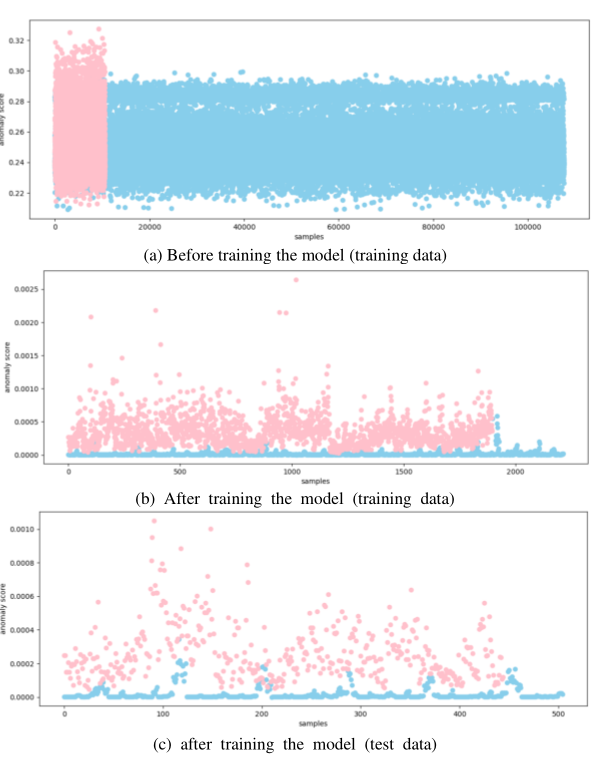
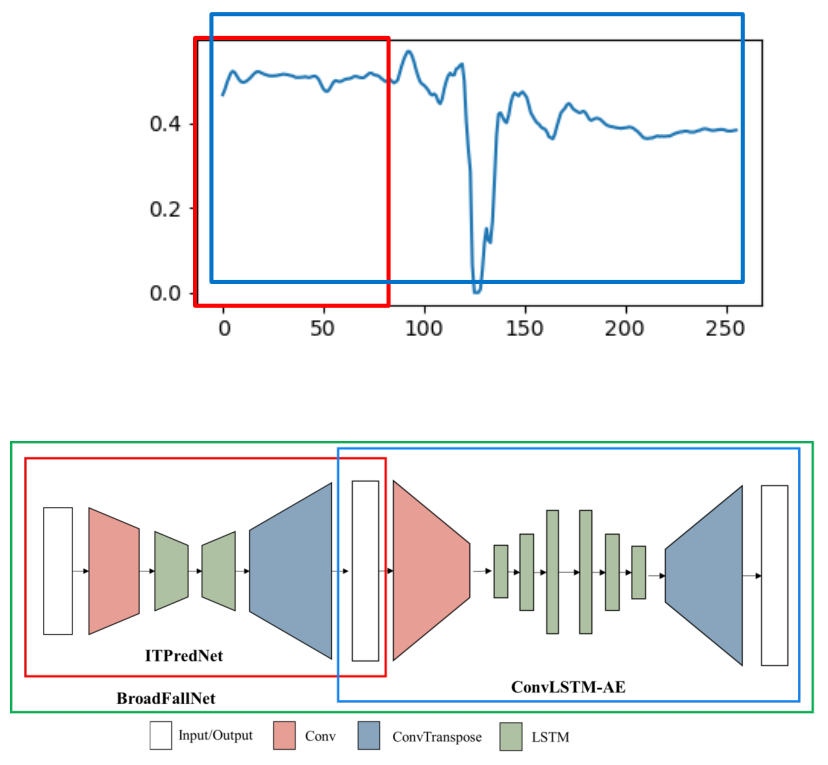

# 처음 보는 낙상을 찾아낼 수 있을까 · 이상치 검출 연구

[포트폴리오](../README.md) · [연구 목록](../research.md)

모든 종류의 낙상을 미리 수집하기는 어렵습니다. 그래서 낙상·일상동작을 모두 학습하는 분류 모델 대신, **정상 동작을 학습한 뒤 낯선 움직임을 찾는 방법**을 연구했습니다.

**2023.01–2023.08 · 박사학위 연구**  
Python · TensorFlow · GANomaly · ConvLSTM Autoencoder · 시계열 예측

## 1. 신호를 복원하는 모델에서 시작

GANomaly와 ConvLSTM Autoencoder를 IMU 시계열에 적용했습니다. 정상 동작은 잘 복원하고 낙상은 복원 오차가 커질 것이라는 접근이었습니다. 모델 구현과 학습, 결과 분석을 담당했습니다.

*학습 전·후 및 시험 데이터의 오차 분포. 개인 포트폴리오 14쪽에 수록한 연구 결과입니다.*

## 2. 충격 전 검출은 무엇이 달랐나

충격 후에는 낙상과 일상동작의 차이가 뚜렷했지만, 충격 직전의 짧은 움직임만으로는 구분이 어려웠습니다. 복원 오차만 보는 방법에서 나아가, **앞으로의 신호를 예측하고 그 결과에 이상치 검출을 적용하는 구조**를 검토했습니다.

*입력·예측 구간과 예측 모델–Autoencoder의 연결 구조. 개인 포트폴리오 13쪽에서 발췌했습니다.*

## 3. 연구가 남긴 질문

1. **검출 시점:** 충격 후에 잘 맞는 모델이 충격 전에도 유효한가?
2. **미관측 동작:** 정상 데이터만 학습하면 처음 보는 낙상에 더 잘 대응하는가?
3. **오경보:** 짧은 시험 구간에서의 성능이 연속 신호에서도 유지되는가?

이 연구는 박사학위 논문에서 다룬 탐색 연구입니다. 당시 결과를 통해 충격 전·후의 문제를 나누고, 연속 동작에서 오경보를 확인하는 평가가 필요하다는 점을 배웠습니다.

**학위논문:** *Robust Pre- and Post-Impact Fall Detection Algorithm Based on Artificial Intelligence*, 연세대학교, 2023.
