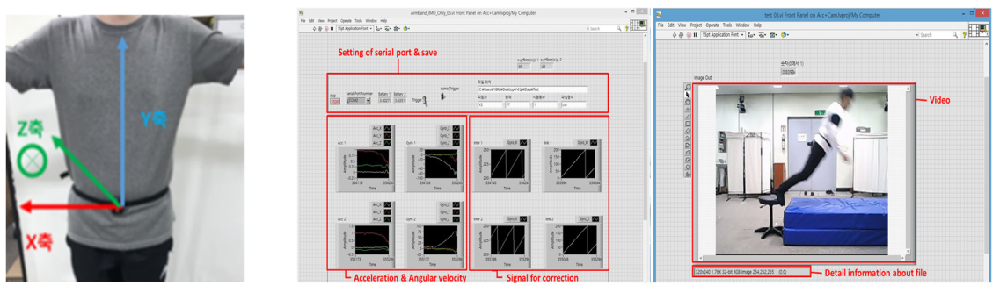
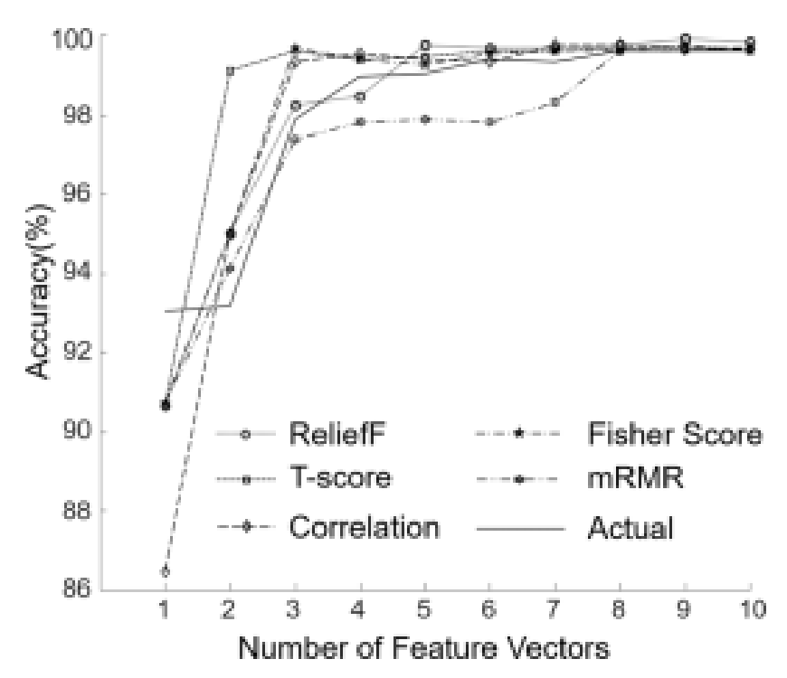

# 센서 수집부터 특성 선택까지 · ANN 낙상 검출 연구

[포트폴리오](../README.md) · [교차 데이터셋 연구](13-cross-dataset.md)

알고리즘을 만들기 전에, 움직임을 제대로 기록할 수 있는 실험 환경부터 필요했습니다. IMU 신호와 영상을 동시에 저장하는 도구를 만들고, 수집한 데이터에서 낙상을 설명하는 특성을 찾았습니다.

## 1. 직접 만든 수집 소프트웨어

MPU9250 IMU와 nRF52832 모듈을 이용한 무선 수집 환경을 연구실 동료들과 구성했습니다. 저는 펌웨어·RF 통신을 다루고, **LabVIEW로 영상과 IMU 신호를 동기화해 저장하는 GUI**를 개발했습니다. 신호만으로 판단하기 어려운 구간은 영상에서 실제 동작과 대조할 수 있도록 했습니다.

*2021년 후속 논문 Figure 1의 센서 배치와 GUI. [Koo et al., Sensors](https://doi.org/10.3390/s21144638), [CC BY 4.0](https://creativecommons.org/licenses/by/4.0/).*

## 2. 32개 특성 중 무엇이 중요할까

건강한 성인 남성 **30명**, **낙상 9종·일상동작 14종**의 신호에서 **32개 특성**을 추출했습니다. ANN의 설정을 탐색한 뒤, ReliefF·T-score·Correlation·Fisher score·mRMR의 **5가지 랭킹 방법**으로 특성 조합을 비교했습니다.

*개인 포트폴리오 6쪽에 수록된 2020년 연구 그래프를 발췌했습니다. [논문 DOI](https://doi.org/10.1007/s12541-020-00398-6)*

| 입력 특성 | 논문 초록에 보고된 정확도 |
|---|---:|
| 전체 32개 특성 | 99.86% |
| T-score 상위 2개 특성 | 99.17% |

특성을 많이 넣는 것보다 어떤 특성을 고르는지가 중요했습니다. 다만 이 결과는 당시 연구실 데이터의 분류 결과입니다. 새로운 데이터에서도 같은 성능을 얻을 수 있는지는 [2021년 교차 데이터셋 연구](13-cross-dataset.md)에서 별도로 살펴봤습니다. 위 수치는 개인 포트폴리오에 포함된 논문 초록을 인용했으며, 해당 발췌본에는 학습·시험 분할과 시험 표본수가 없습니다.

**논문:** Koo, B., et al. (2020). [Post-fall Detection Using ANN Based on Ranking Algorithms](https://doi.org/10.1007/s12541-020-00398-6). *International Journal of Precision Engineering and Manufacturing*, 21, 1985–1995. 제1저자.
