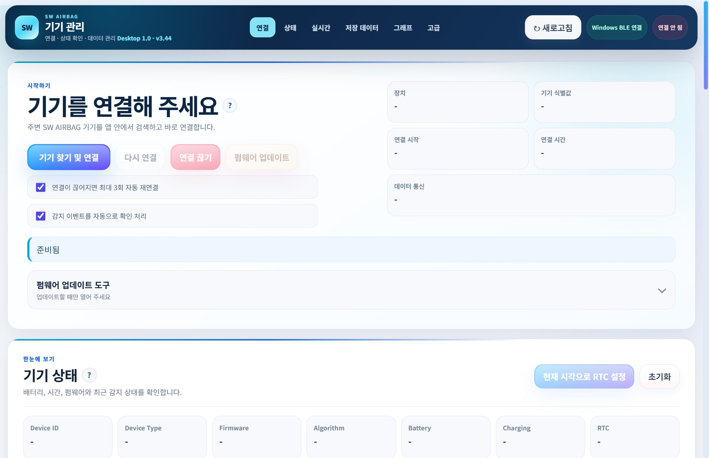
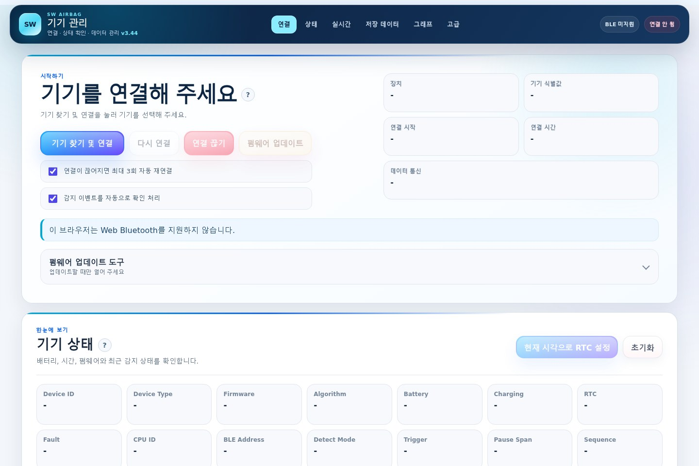
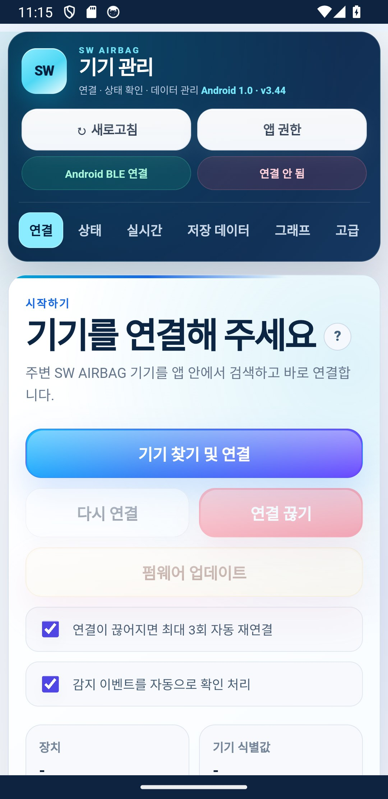

# 🌐 SW AIRBAG · Web, Windows & Android

**BLE 센서의 연결·상태·기록·업데이트를 여러 실행 환경에서 다루는 소프트웨어를 개발했습니다.** 공통 웹 UI를 바탕으로 브라우저, Windows 앱과 Android 앱의 연결 방식과 생명주기를 각각 다뤘습니다.

> English: A cross-platform BLE sensor-management suite with a shared web interface and platform-specific bridges, lifecycle handling and regression tests.

*Windows 앱의 연결 전 화면. 실제 장치 식별자와 수집 데이터는 포함하지 않았습니다.*

## 1. 해결하려는 문제

센서 데이터만 수집하는 것으로는 개발 흐름이 끝나지 않습니다. 장치 상태 확인, 모드 전환, 기록 다운로드, 연결 중단 후 복구, 펌웨어 업데이트를 일관된 화면에서 수행할 수 있어야 합니다. 실행 환경이 바뀌면 브라우저 권한, BLE API, 파일 저장과 창 종료 처리도 달라집니다.

## 2. 구현한 범위

| 프로그램 | 구현과 설계 | 소스 기준 |
|---|---|---|
| 🌐 Web | Web Bluetooth와 Python/Bleak 브리지, 상태·차트·기록·DFU 화면 | v3.44 |
| 🖥️ Windows | pywebview·WebView2 창, 로컬 BLE 서비스, 새로고침·종료 시 연결 정리 | v1.0.0 |
| 📱 Android | Capacitor BLE 브리지, 네이티브 파일 저장·공유, 권한·연결 상태 처리 | v1.0.0 |

*웹의 연결 전 UI와 Android 에뮬레이터 화면입니다.*

## 3. 중요하게 다룬 동작

1. **연결 복구:** 연결 경합, 중단, 재연결과 서비스 갱신을 테스트 가능한 흐름으로 나눴습니다.
2. **업데이트 중 상태 관리:** 전송 중 새로고침·종료로 작업이 끊기지 않도록 앱 생명주기를 다뤘습니다.
3. **플랫폼 연결 계층:** 공통 UI와 브라우저·Python·Android BLE 연결 계층을 분리했습니다.
4. **배포 준비:** Windows 패키지 구성과 Android assets·플러그인 준비 과정을 스크립트로 관리했습니다.

## 4. 확인한 범위

개발 기록에는 Windows 패키지 UI 실행과 Android 에뮬레이터의 파일 저장·ZIP 처리·화면 크기·새로고침 방지 확인이 있습니다. 이관 시 기존 모의 BLE·생명주기 회귀 테스트를 실행했습니다. Android 에뮬레이터에서는 실제 BLE 스캔·연결을 검증하지 않았습니다. 이 결과를 모든 장치·펌웨어 조합의 현장 검증으로 해석하지 않습니다.

이 Android 앱은 2026년 Capacitor 기반 관리 앱이며, [2023–2024년 Kotlin·TFLite 연구 앱](04-android-sensor-app.md)과 별도 프로젝트입니다.

**기술:** JavaScript · Python · Bleak · Web Bluetooth · pywebview · WebView2 · Capacitor · Android

[소스·실행 안내 — 비공개 저장소](https://github.com/BummoK/Elderly_Fall_Detection/tree/master/software) · [포트폴리오로 돌아가기](../README.md)
