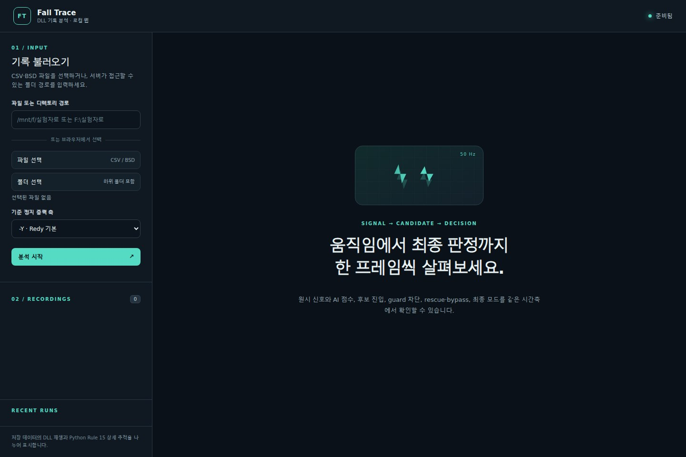

# 🔎 평가 도구의 발전 · 데이터 검사에서 Fall Trace까지

**모델 결과를 확인하는 도구에서 출발해, 원본 입력과 실행 결과의 차이를 추적할 수 있는 분석 환경으로 확장했습니다.**

> English: An evolution from data-quality inspection and evaluation GUIs to time-aligned analysis of recorded sensor data and native replay outputs.

*Fall Trace의 데이터 입력 전 화면. 저장 기록의 호스트 분석 도구이며 현장 알람 화면이 아닙니다.*

## 1. 개발 흐름

| 시기 | 개발 과제 | 다룬 문제 |
|---|---|---|
| 2024.06 | 실험 데이터 검증·평가 플랫폼 | 수집 신호 변환, 누락·중복 프레임 점검, 이벤트와 검출 결과 비교 |
| 2024.08 | 시험평가용 소프트웨어 | 폴더 단위 입력, TFLite 추론·평가 GUI, 실행 파일 배포와 다른 PC 실행 확인 |
| 2025.04 | 리드타임 분석 UI | 폴더별 분석 실행, 결과 통계 정리, 반복 작업을 줄이는 GUI |
| 2026.10 | Fall Trace | 저장 기록·모델 출력·네이티브 실행 결과를 시간축에서 조사하는 웹 UI |

2024–2025년 내용은 2026-10-06에 보관된 Notion 원문 개발 기록에 근거합니다. 최신 Notion 페이지를 다시 조회한 결과로 표현하지 않습니다. 2026년 내용은 현재 소스와 개발 기록을 대조했습니다.

## 2. 현재 도구에서 구현한 것

1. CSV·BSD 저장 기록과 분석 작업을 로컬 웹 UI에서 관리합니다.
2. 센서 신호, 모델 출력과 판정 이벤트를 같은 시간축에서 살펴봅니다.
3. 입력 기록과 실행 결과를 연결하여 오류 원인을 재검토할 수 있게 합니다.
4. 네이티브 DLL 재생 결과와 Python 분석 결과를 구분합니다.

판정은 **AI 추정과 물리적·시계열적 움직임 특성을 종합한 판정**으로 설명합니다. 내부 임계값이나 세부 판정식은 공개하지 않습니다.

## 3. 이 경험이 보여주는 것

분석 결과를 화면에 표시하는 것에 더해, 입력 품질·실행 환경·판정 버전·검출 시점이 결과 해석에 미치는 영향을 추적했습니다. 반복되는 폴더 처리와 결과 정리를 도구로 옮겨 개발자가 실패 사례 조사에 집중할 수 있도록 구성했습니다.

현재 패키지의 UI와 Python 소스는 보관했으며, 실제 분석에는 별도 네이티브 도구와 DLL이 필요합니다. 자동 테스트와 저장 데이터 재생은 실기기 최종 알람·현장 성능 검증을 대신하지 않습니다.

**기술:** Python · JavaScript · NumPy · pandas · SciPy · TFLite 평가 도구 · 네이티브 실행 비교

[평가·원인 분석 사례](02-evaluation.md) · [소스 — 비공개](https://github.com/BummoK/Elderly_Fall_Detection/tree/master/software/recording-inspector) · [포트폴리오](../README.md)
