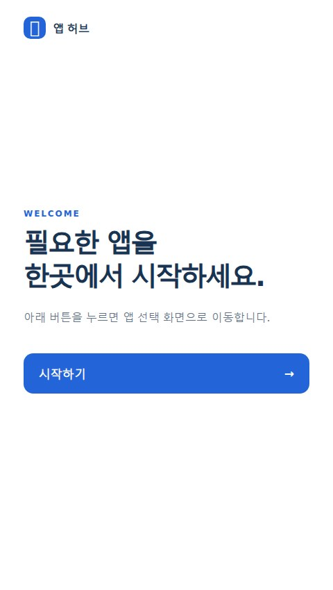

# 🚀 모바일 Web App Launcher

**시작 화면에서 앱을 선택하고 실행 링크를 설정하는 작은 웹 도구입니다.**

## 1. 구현

- HTML·CSS·JavaScript로 빌드 단계 없는 정적 웹 UI 구성
- 시작 → 앱 선택 → 링크 설정의 간단한 화면 흐름
- 앱 이름과 링크를 브라우저 localStorage에 보관
- 모바일 화면에 맞춘 버튼과 레이아웃

## 2. 앱 연결에서 남은 작업

Android에서 웹 링크로 앱을 열려면 대상 APK가 `BROWSABLE` 딥링크를 지원해야 합니다. 확인한 Redy·FRAS APK에는 해당 필터가 없어, 현재 버튼은 실행 링크 설정을 엽니다. 앱을 바로 열려면 대상 Android 앱에도 딥링크 설정을 추가해야 합니다.

**기술:** HTML · CSS · Vanilla JavaScript · localStorage · Android manifest 분석

[소스·사용 안내 — 비공개](https://github.com/BummoK/Elderly_Fall_Detection/tree/master/software/web-launcher) · [포트폴리오](../README.md)
