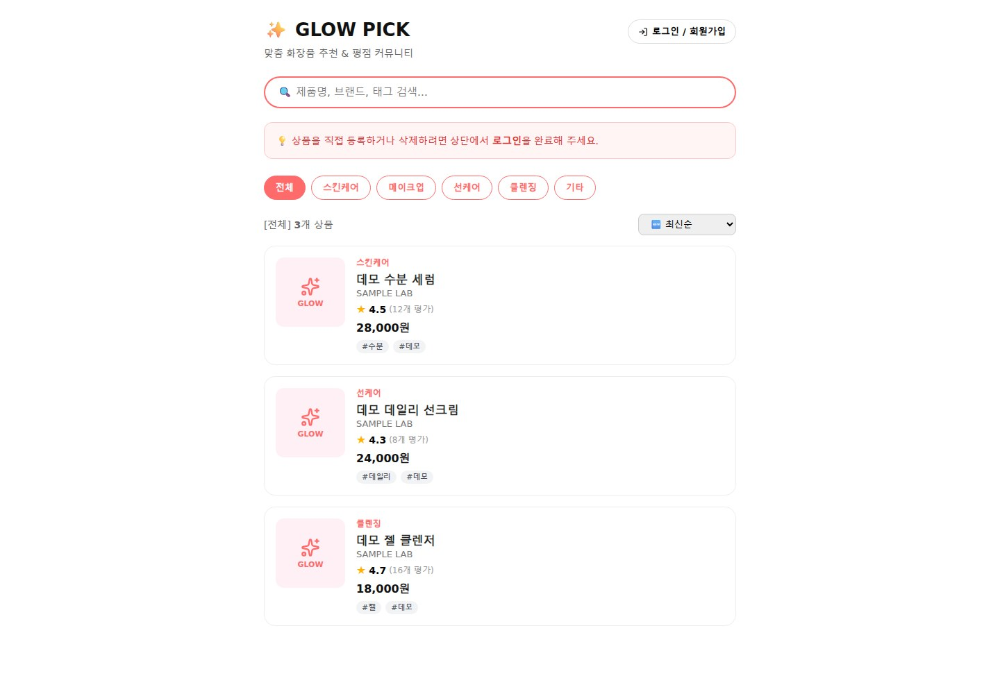

# ✨ GLOW PICK · 화장품 탐색과 리뷰

**상품 탐색부터 상세·리뷰·사용자 흐름까지 연결한 개인 풀스택 프로젝트입니다.**

*테스트용 상품 3개를 넣은 개발 화면입니다.*

## 1. 만든 기능

| 사용자 경험 | 구현 |
|---|---|
| 원하는 상품 찾기 | 이름·브랜드·태그 검색, 카테고리 필터, 정렬 |
| 상품 살펴보기 | 상세 화면, 리뷰와 평점 표시 |
| 사용자 흐름 | 회원가입·로그인 UI와 인증 API |
| 데이터 관리 | Express 상품·리뷰 API와 MongoDB 모델 |

React 라우팅, API 호출, 서버 라우트와 데이터 모델을 하나의 프로젝트로 연결했습니다. 아이콘과 알림 메시지를 사용해 화면 피드백을 구성했습니다.

## 2. 개발 상태

학습과 포트폴리오를 위해 만든 프로토타입입니다. 프런트엔드 빌드와 테스트 상품의 화면을 확인했고, API 주소 통일과 인증·권한 처리는 더 보완할 계획입니다.

**기술:** React 19 · Vite · React Router · Express 5 · MongoDB · Mongoose · JavaScript

[소스·실행 안내 — 비공개](https://github.com/BummoK/cosmetic-app) · [포트폴리오](../README.md)
