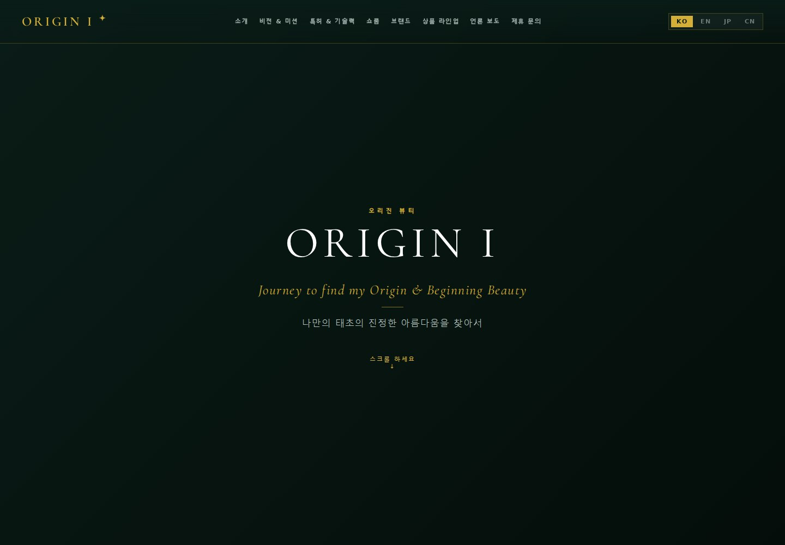
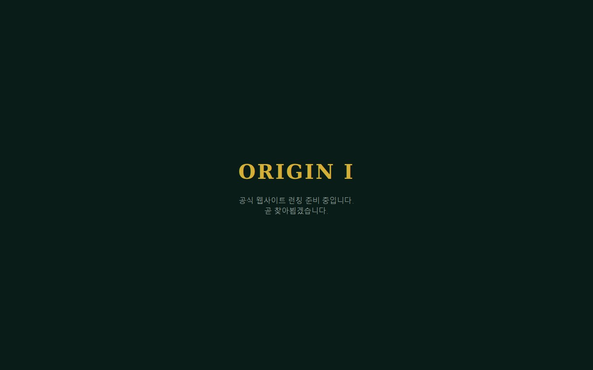

# 🌿 ORIGIN I · 브랜드 웹사이트

**딥그린·골드·타이포그래피를 중심으로 브랜드 콘텐츠를 구성한 개인 웹 프로젝트입니다.**

> English: A responsive brand-site prototype with editorial sections, Korean/English content switching and a separate Coming Soon entry page.

*보관된 브랜드 전체 페이지 프로토타입의 로컬 화면입니다.*

## 1. 구현 경험

- 브랜드 소개와 제품·사업 콘텐츠를 연결하는 페이지 구성
- 반응형 레이아웃, 가로 카드 탐색과 스크롤 등장 효과
- 한국어·영어 콘텐츠 전환
- 문의 폼 UI와 입력 후 피드백

## 2. 현재 상태

저장소의 현재 기본 페이지는 **Coming Soon**이며, 전체 브랜드 페이지는 별도 HTML 프로토타입으로 보관되어 있습니다. 문의 폼의 실제 메시지 전송과 외부 스토어 연결은 별도 작업입니다. 화면은 로컬 소스 확인 결과로, 운영 도메인의 현재 배포 상태를 주장하지 않습니다.

**기술:** HTML · CSS · JavaScript · Responsive UI · KO/EN 콘텐츠 전환

[소스·미리보기 안내 — 비공개](https://github.com/BummoK/origini-website) · [포트폴리오](../README.md)
