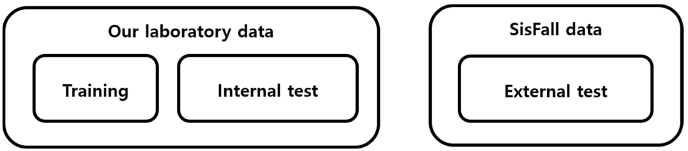
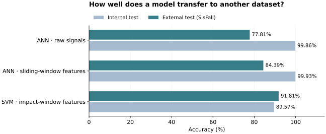

# 다른 데이터에서도 작동하는 낙상 검출 모델을 찾아서

[포트폴리오](../README.md) · [연구 목록](../research.md)

연구실 데이터에서는 정확도가 높았지만, 다른 연구팀이 수집한 동작에서는 같은 결과가 나오지 않았습니다. **어떤 입력 특성과 학습 조건이 새로운 동작에 잘 대응하는지** 확인하기 위해 연구실 데이터와 SisFall을 교차 평가했습니다.

**2021년 Sensors 게재 · 제1저자**  
MATLAB · ANN · SVM · 특성 추출 · IMU · LabVIEW

## 1. 실험부터 평가까지

30명의 건강한 성인 남성을 대상으로 **낙상 9종과 일상동작 14종**, 총 23개 동작을 각 3회 수집했습니다. 골반 앞쪽에 장착한 IMU로 가속도·각속도를 100 Hz로 측정하고, LabVIEW에서 영상과 함께 저장했습니다. 저는 실험 설계·수행과 데이터 분석, 펌웨어·소프트웨어 개발, 논문 작성에 참여했습니다.

*Koo et al., 2021, Figure 6. [원문](https://doi.org/10.3390/s21144638), [CC BY 4.0](https://creativecommons.org/licenses/by/4.0/).*

## 2. 입력을 바꾸면 일반화 성능도 달라질까

원신호, 이동 창에서 추출한 특성(SWF), 충격 구간에서 추출한 특성(IDWF)을 ANN·SVM에 각각 적용했습니다. 정규화, 클래스 균형 조정, 학습 데이터 확대, 외부 데이터 추가 학습도 비교했습니다.

| 모델·입력 | 내부 시험 정확도 | 외부 SisFall 정확도 | 외부 민감도 | 외부 특이도 |
|---|---:|---:|---:|---:|
| ANN · 원신호 | 99.86% | 77.81% | 64.87% | 90.09% |
| ANN · 이동 창 특성 | 99.93% | 84.39% | 76.99% | 91.41% |
| SVM · 충격 구간 특성 | 89.57% | 91.81% | 90.72% | 92.85% |

*논문 Table 3의 추가 처리 없음(None) 조건을 발췌했습니다. 기본 학습은 연구실 참여자 10명, 내부 시험은 나머지 20명이며 외부 시험에는 SisFall의 젊은 성인 23명 데이터를 사용했습니다. 내부·외부 시험은 서로 다른 동작 구성입니다. 논문 표에는 조건별 TP·TN·FP·FN 원수가 없어 백분율을 그대로 옮겼습니다.*

## 3. 숫자보다 중요했던 실패 동작

ANN은 시계열 특성에, SVM은 충격 구간의 요약 특성에 더 잘 맞았습니다. 특히 옆으로 눕는 동작과 천천히 주저앉는 낙상이 오류 분석에서 중요했습니다. 학습에 없던 움직임을 더 모으고, 실패 동작을 따로 살펴봐야 한다는 결론을 얻었습니다.

이 경험은 이후 TinyFallNet의 고령자 평가와 현재 업무의 동작별 오경보 분석으로 이어졌습니다.

**논문:** Koo, B., Kim, J., Nam, Y., & Kim, Y. (2021). [The Performance of Post-Fall Detection Using the Cross-Dataset: Feature Vectors, Classifiers and Processing Conditions](https://doi.org/10.3390/s21144638). *Sensors*, 21(14), 4638.
