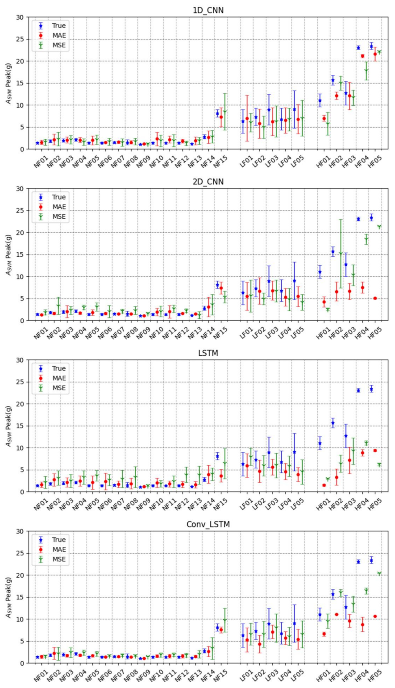

# 건설현장 추락 · 충격의 크기를 미리 예측하는 연구

[포트폴리오](../README.md) · [정부·기업 과제](../funded-projects.md)

작업 중의 큰 움직임과 위험한 추락을 구별하기 위해, 낙상 여부를 바로 분류하는 대신 **앞으로 발생할 충격 가속도를 예측하는 방법**을 연구했습니다.

**2022년 Sensors 게재 · 공동 제1저자**  
논문의 동등 기여 저자이며, 연구 구상·데이터 정리·논문 초고 및 수정에 참여했습니다. 모델 구현은 공동연구자가 담당했습니다.

## 1. 실험 구성

1. 성인 남성 **20명**과 더미를 사용해 일반 작업 15종, 저위험 낙상 5종, 고위험 추락 5종을 수집했습니다.
2. 등쪽 T7 위치의 IMU에서 가속도·각속도를 100 Hz로 측정했습니다. 2 m·3 m 추락 실험에는 더미를 사용했습니다.
3. 최대 충격 **0.7초 전부터 0.2초 전까지의 0.5초 구간**으로 이후의 충격 크기를 예측했습니다.
4. 사람 데이터는 70% 학습·30% 시험, 더미 데이터는 60% 학습·40% 시험으로 나눴습니다.

## 2. 네 모델의 예측 결과

| 모델 | MAE로 학습한 모델의 평균 절대 오차 |
|---|---:|
| 1D-CNN | 1.46 g |
| 2D-CNN | 1.61 g |
| LSTM | 2.07 g |
| **Conv-LSTM** | **1.36 g** |

*Lee, Koo et al., 2022, Table 3. 각 모델의 선택된 설정에서 얻은 시험 결과입니다. 충격 크기의 회귀 오차로, 낙상 검출률과는 다른 지표입니다.*

*Figure 3. 작업·낙상 종류별 실측값과 예측값의 평균·표준편차. 논문 원본 그림, [CC BY 4.0](https://creativecommons.org/licenses/by/4.0/). [원문](https://doi.org/10.3390/s22166107)*

## 3. 정확도와 민감도를 함께 본 이유

예측한 충격 크기로 고위험 추락을 분류했을 때, MAE로 학습한 Conv-LSTM의 **정확도는 97.6%, 민감도는 62.5%, 특이도는 100%**였습니다. MSE로 학습한 Conv-LSTM은 각각 **92.3%, 95.8%, 92.0%**였습니다(Table 4).

높은 전체 정확도가 위험 동작을 빠짐없이 찾아낸다는 뜻은 아니었습니다. 이 연구에서는 예측 오차뿐 아니라 놓친 추락과 잘못 울린 경보를 함께 살펴봤습니다. 수치는 사람·더미의 실험 데이터 시험 결과이며, 논문 Table 4에 혼동행렬 원수는 따로 제시되어 있지 않습니다.

**논문:** Lee, S., **Koo, B.**, et al. (2022). [Fall-from-Height Detection Using Deep Learning Based on IMU Sensor Data for Accident Prevention at Construction Sites](https://doi.org/10.3390/s22166107). *Sensors*, 22(16), 6107. Lee와 Koo는 동등 기여 저자입니다.
