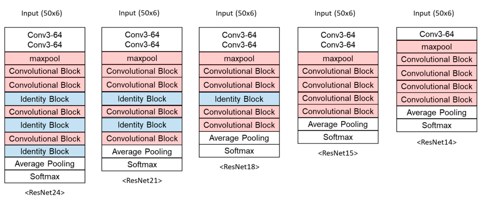

# 사람의 움직임을 이해하는 연구

[포트폴리오](README.md) · [정부·기업 과제](funded-projects.md) · [Google Scholar](https://scholar.google.co.kr/citations?user=r-tpjqAAAAAJ)

센서 신호에서 낙상을 찾아내는 연구로 시작해, 충격 전에 판단하는 모델과 작은 장치에서 실행할 수 있는 구조를 고민해 왔습니다. 실험실에서 잘 맞는 모델이 다른 사람과 다른 움직임에도 통하는지 확인하는 것이 제 연구의 중요한 질문이었습니다.

## 1. 연구의 흐름

| 연구 | 질문 | 주요 내용 |
|---|---|---|
| [ANN·특성 선택, 2020](projects/07-sensor-acquisition.md) | 적은 특성으로도 낙상을 검출할 수 있을까? | 30명·23개 동작, 32개 특성과 5개 랭킹 방법 비교 |
| [교차 데이터셋 평가, 2021](projects/13-cross-dataset.md) | 처음 보는 동작에서도 잘 작동할까? | 연구실 데이터와 SisFall, ANN·SVM 및 입력 특성 비교 |
| [건설현장 추락, 2022](projects/14-construction-fall.md) | 충격의 크기를 미리 알 수 있을까? | 20명·더미 실험, Conv-LSTM 충격 예측 MAE 1.36 g |
| [TinyFallNet, 2023](projects/05-tinyfallnet.md) | 충격 전에 판단하는 모델을 줄일 수 있을까? | 0.70 MB 모델, 고령자 낙상 13/15건·일상동작 627/640건 판정 |
| [이상치 검출, 2023](projects/06-anomaly-detection.md) | 정상 동작만 학습해 낯선 낙상을 찾을 수 있을까? | GANomaly·ConvLSTM Autoencoder·미래 신호 예측 |
| [Android 연구 앱, 2023–2024](projects/04-android-sensor-app.md) | 연구 모델을 휴대전화에서 확인할 수 있을까? | BLE 센서 수신·차트·저장·TensorFlow Lite 통합 |

각 수치의 데이터 구성과 시험 조건은 연결된 연구 페이지에 정리했습니다.

## 2. 대표 연구 장면

### 모델 구조를 줄이고, 실제 고령자 데이터에서 다시 평가했습니다

*TinyFallNet Figure 4, Koo et al., 2023. [논문](https://doi.org/10.3390/s23208459) · [CC BY 4.0](https://creativecommons.org/licenses/by/4.0/)*

ResNet24에서 불필요한 층을 줄여 14층 모델을 만들었습니다. 고령자의 일상동작에서는 오경보 원인을 따로 분석하고 시간에 따른 판정을 보완했습니다. [모델 비교표·평가 결과 →](projects/05-tinyfallnet.md)

### 데이터를 직접 모으고, 다른 데이터셋과 비교했습니다

*Cross-dataset 연구 Figure 1, Koo et al., 2021. [논문](https://doi.org/10.3390/s21144638) · [CC BY 4.0](https://creativecommons.org/licenses/by/4.0/)*

IMU와 영상의 동기화 수집부터 모델 평가까지 직접 다뤘습니다. 같은 모델도 입력 특성과 시험 데이터에 따라 결과가 달라지는 이유를 분석했습니다. [교차 평가 그래프·결과 →](projects/13-cross-dataset.md)

## 3. 대표 논문

| 연도 | 논문 | 저자 역할 |
|---|---|---|
| 2023 | [TinyFallNet: A Lightweight Pre-Impact Fall Detection Model](https://doi.org/10.3390/s23208459), *Sensors* 23(20), 8459 | **제1저자** |
| 2022 | [Fall-from-Height Detection Using Deep Learning Based on IMU Sensor Data for Accident Prevention at Construction Sites](https://doi.org/10.3390/s22166107), *Sensors* 22(16), 6107 | **공동 제1저자** |
| 2021 | [The Performance of Post-Fall Detection Using the Cross-Dataset: Feature Vectors, Classifiers and Processing Conditions](https://doi.org/10.3390/s21144638), *Sensors* 21(14), 4638 | **제1저자** |
| 2020 | [Post-fall Detection Using ANN Based on Ranking Algorithms](https://doi.org/10.1007/s12541-020-00398-6), *International Journal of Precision Engineering and Manufacturing* 21, 1985–1995 | **제1저자** |
| 2024 | [Determination of Gait Events and Temporal Gait Parameters for Persons with a Knee–Ankle–Foot Orthosis](https://doi.org/10.3390/s24030964), *Sensors* 24(3), 964 | 공동저자 · 방법론·조사 |
| 2020 | [Enhanced Algorithm for the Detection of Preimpact Fall for Wearable Airbags](https://doi.org/10.3390/s20051277), *Sensors* 20(5), 1277 | 공동저자 |
| 2020 | [Detection of Pre-Impact Falls from Heights Using an Inertial Measurement Unit Sensor](https://doi.org/10.3390/s20185388), *Sensors* 20(18), 5388 | 공동저자 |

## 4. 학력과 경력

1. **세이프웨어(주), 2024.05–현재** — SW개발실 알고리즘 개발팀 팀장·책임연구원.
2. **연세대학교 생체역학연구실 연구원** — 박사학위 취득 후 IMU 기반 알고리즘과 모바일 앱 개발.
3. **연세대학교 의공학 박사, 2018.03–2023.08** — 석박사통합과정, 학점 4.23/4.3. 학위논문: *Robust Pre- and Post-Impact Fall Detection Algorithm Based on Artificial Intelligence*.
4. **연세대학교 의공학 학사, 2012.03–2018.02**.

## 5. 발표와 연구 활동

1. **BMES 2022, 미국 San Antonio** — *Pre-Impact Fall Detection Using ConvLSTM and ResNet* 발표.
2. **AP Biomech 2023, 말레이시아 Kuala Lumpur** — *Development and Evaluation of Robust Fall Detection Algorithm Using Elderly Public Datasets* 구두 발표.
3. **대한생체역학회 최우수 포스터 발표상, 2017** — MEMS 마이크로폰을 이용한 정상·무릎 골관절염 대상자의 무릎 음향 특성 연구.
4. **의공학과 대학원 학생대표, 2021.09–2022.02**. 생체역학·동작분석·재활공학 등 과목의 조교 활동.

[정부·기업 과제 12건의 참여 이력 →](funded-projects.md) · [그림 출처](assets/research/README.md)
